# KnowFlow AI — A2: Accumulate Master Know-How for AI to Learn

Biến video dịch vụ thành tri thức **kiểm tra được**: mỗi bước có claim, mỗi claim có
bằng chứng mở được, phần chưa biết được giữ lại và chuyển thành câu hỏi.

## Dành cho Ban giám khảo

| Nội dung | Tài liệu |
|---|---|
| Vấn đề, giải pháp, điểm khác biệt và kế hoạch triển khai | [Ý tưởng A2](docs/a2_idea_submission.md) |
| Quy trình sử dụng hai giao diện | [Kịch bản demo giao diện mới](docs/demo_recording_new_ui.md) |
| Đồ thị, nhánh có điều kiện, revision và đường truy xuất | [Không gian tri thức 3D](docs/a2_knowledge_space_3d.md) |
| Bằng chứng kỹ thuật, tốc độ, chi phí và giới hạn | [Benchmark A/B/C trên 81 câu](benchmarks/results/20261012_expanded_dev/REPORT.md) · [Số liệu cho slide](benchmarks/results/20261012_expanded_dev/SLIDE.md) |
| Tự chạy demo | [Hướng dẫn chạy hai web](#chay-web) |

Pilot dùng nguồn Haas real/dev công khai: **9 workflow active, 67 bước, 303 claim**.
Các claim đã được đối chiếu nguồn; chưa có xác nhận kỹ thuật từ chuyên gia.
Benchmark hiện giữ nguyên 81 nhãn; 20 nhãn phủ định chờ quyết định review trên corpus
mở rộng. Recall@5 là kết quả truy xuất, chất lượng nghĩa của đáp án ở lượt này chưa
có người chấm. Phép đo A/C chưa chứng minh lợi ích của cạnh đồ thị.

## Luồng hệ thống

```mermaid
flowchart LR
    S[Video và tài liệu nguồn] --> E[Transcript, keyframe và timestamp]
    E --> K[Bước, claim, quan hệ và bằng chứng]
    K --> R[Người kiểm đối chiếu nguồn]
    R --> V[Snapshot có revision]
    V --> I[Chỉ mục lexical và embedding]
    I --> Q[QAService: truy xuất, sinh đáp án, kiểm citation]
    Q --> W[Web đọc và graph 3D]
    K --> M[Phần thiếu và câu hỏi bổ sung]
    M --> F[Phản hồi của người có chuyên môn]
    F --> R
```



Trang `/` có bản đồ bước–quan hệ, hỏi đáp, bằng chứng, bổ sung và lịch sử.
Trang `/space` có toàn cảnh 3D, nhánh theo tình huống, so sánh revision và trace
backend. Chuyển động của trace trình bày các chặng pipeline quan sát được.

<a id="chay-web"></a>

## Chạy web local — Windows / PowerShell

Chạy các lệnh từ **thư mục gốc repository**. Một server phục vụ cả hai giao diện:

| Địa chỉ | Chức năng |
|---|---|
| <http://127.0.0.1:8000/> | Đọc quy trình, hỏi đáp, bằng chứng, bổ sung và lịch sử revision |
| <http://127.0.0.1:8000/space> | Graph 3D, nhánh có điều kiện, so sánh revision và đường truy xuất |
| <http://127.0.0.1:8000/docs> | Tài liệu API |

### 1. Cài môi trường lần đầu

Nếu đã có `.venv`, bỏ qua lệnh tạo môi trường và cài các dependency cần cho web:

```powershell
uv venv --python 3.12
uv pip install --python .venv/Scripts/python.exe -e ".[dev,api,retrieval]"
```

Không có `uv`, dùng Python 3.12:

```powershell
py -3.12 -m venv .venv
.\.venv\Scripts\python.exe -m pip install -e ".[dev,api,retrieval]"
```

### 2. Mở trang đọc và graph, có lịch sử revision

Chuẩn bị database real/dev riêng, gồm index của các revision đủ điều kiện.
Bước này không gọi Gemini và không sửa corpus đã commit.

```powershell
.\.venv\Scripts\python.exe -m scripts.prepare_knowledge_space --db out/retrieval/web_demo.sqlite
$env:KNOWFLOW_REAL_DEV_DB = 'out/retrieval/web_demo.sqlite'
$env:KNOWFLOW_RETRIEVAL_STRATEGY = 'lexical'
.\.venv\Scripts\python.exe -m retrieval.api
```

Giữ terminal đang chạy và mở hai địa chỉ ở bảng trên. Chọn **Nguồn thực · dev**
ở trang đọc hoặc **Nguồn Haas · pilot** ở trang 3D. Dừng server bằng `Ctrl+C`.

Chế độ này dùng được bản đồ, nguồn, lịch sử và trace chỉ truy xuất mà không cần
key. Hỏi đáp và tùy chọn **Tạo câu trả lời AI sau truy xuất** vẫn cần Gemini key.
Lexical không tự dịch câu hỏi tiếng Việt; dùng câu hỏi tiếng Anh để thử truy xuất
trên nguồn tiếng Anh, hoặc bật hybrid theo bước 3.

### 3. Bật embedding, dịch câu hỏi và trả lời Gemini

Nếu chưa có `.env`, tạo từ mẫu; lệnh dưới giữ nguyên `.env` đã có:

```powershell
if (-not (Test-Path -LiteralPath .env)) { Copy-Item -LiteralPath .env.example -Destination .env }
```

Điền `GEMINI_API_KEY` trong `.env`. Dừng server đang chạy, rồi dựng embedding
cho index hiện tại và khởi động lại:

```powershell
.\.venv\Scripts\python.exe -m retrieval.retrieval build --db out/retrieval/web_demo.sqlite --mode real --split dev --embedding gemini
$env:KNOWFLOW_REAL_DEV_DB = 'out/retrieval/web_demo.sqlite'
$env:KNOWFLOW_RETRIEVAL_STRATEGY = 'hybrid'
$env:KNOWFLOW_ANSWER_MODEL = 'gemini-3.5-flash-lite'
.\.venv\Scripts\python.exe -m retrieval.api
```

Build gửi nội dung search records sang Gemini để tạo embedding. Hỏi đáp hybrid
gọi embedding câu hỏi, dịch khi cần và sinh/kiểm câu trả lời thật; có phí API theo
tài khoản. Các index lịch sử đã chuẩn bị ở bước 2 được giữ lại.

Thử câu **“Bôi trơn con trượt của hốc dao trước khi lắp như thế nào?”**, phạm vi
**Haas / SMTC**, để trống model máy; bấm citation để mở đoạn nguồn. Ở `/space`,
chọn **Đường truy xuất** và bật tạo câu trả lời AI nếu muốn xem cả lượt hỏi đáp.

### 4. Những lần mở tiếp theo

Khi database đã có index hybrid phù hợp, chỉ cần chạy trong terminal mới:

```powershell
$env:KNOWFLOW_REAL_DEV_DB = 'out/retrieval/web_demo.sqlite'
$env:KNOWFLOW_RETRIEVAL_STRATEGY = 'hybrid'
.\.venv\Scripts\python.exe -m retrieval.api
```

Biến `$env:...` áp dụng cho terminal hiện tại; đặt lại nếu mở terminal khác.
Sau khi cập nhật giao diện, dùng `Ctrl+F5` trên browser.

| Tình huống | Cách xử lý |
|---|---|
| Database thiếu lịch sử hoặc corpus mới có thêm revision | Chuẩn bị file mới, ví dụ `--db out/retrieval/web_demo_v2.sqlite`; dùng cùng đường dẫn mới khi build và đặt `KNOWFLOW_REAL_DEV_DB`. |
| Index không có vector nhưng đang chọn hybrid | Build `--embedding gemini`, hoặc đặt strategy `lexical` để đọc/truy xuất không vector. |
| API báo `429` / `504` | Hạn mức hoặc timeout của lượt gọi; xem thông báo và chờ trước khi gửi lượt mới. |
| Port 8000 đang được dùng | Chạy `.\.venv\Scripts\python.exe -m retrieval.api --port 8001`, rồi mở hai trang ở port 8001. |

Hướng dẫn sâu hơn: [API và chính sách citation](docs/api_reference.md),
[graph, lịch sử và đường truy xuất](docs/a2_knowledge_space_3d.md).
Danh mục tài liệu kỹ thuật và hồ sơ đối chiếu: [docs/README.md](docs/README.md).

## Bắt đầu

```bash
uv venv --python 3.12
uv pip install -e ".[dev]"

python scripts/build_fixtures.py          # sinh 10 contract fixture
pytest                                    # bộ contract tests dùng chung cho hai đội
knowflow-contracts validate data/fixtures/F01_complete -v
```

Không có `uv` thì dùng `python -m venv .venv` rồi `pip install -e ".[dev]"`.

## Chạy B0 và xử lý lại draft

PowerShell không bắt buộc activate môi trường; có thể dùng `uv run python` hoặc
`.\.venv\Scripts\python.exe`. Chạy từ thư mục gốc repo:

```powershell
uv run python -m acquisition.extraction.extraction_pipeline --source-id SRC_HAAS_0005 --dry-run
```

Chạy thật cần SDK của provider và API key trong `.env`. Để xử lý lại draft đã có
mà không gọi API, dùng `--from-draft`:

```powershell
uv run python -m acquisition.extraction.extraction_pipeline --source-id SRC_HAAS_0005 --from-draft data/workflows/drafts/SRC_HAAS_0005.test.draft.json --output data/workflows/drafts/SRC_HAAS_0005.test.normalized.draft.json --bundle-dir data/workflows/drafts/bundle_SRC_HAAS_0005_test --verbose
uv run python -m acquisition.extraction.compile_workflow data/workflows/drafts/SRC_HAAS_0005.test.normalized.draft.json
uv run knowflow-contracts validate data/workflows/drafts/bundle_SRC_HAAS_0005_test -v
```

Pipeline giữ JSON trước chuẩn hóa cạnh output với hậu tố `.raw.json`, tách các
evidence span không liên tiếp rồi compile và validate trước khi ghi draft.
Lỗi compile/contract sẽ dừng chương trình với exit code 1, giữ bản thô để kiểm tra;
không thay draft hoặc bundle hiện có bằng kết quả lỗi. `--no-bundle` vẫn kiểm tra
compile và contract. Đường dẫn tương đối và tuyệt đối đều được hỗ trợ.

`--from-draft` giữ file đầu vào; nếu bỏ `--output`, tạo file `.normalized.draft.json`
riêng. Provider/model của bản cũ chỉ được ghi vào lineage nếu người chạy truyền
`--provider`/`--model` và được đánh dấu `user_supplied`; không gán phiên bản prompt
hiện tại cho bản cũ. Bundle B0 thử nghiệm vẫn có claims `source_review=pending`;
cần review trước khi promote và bàn giao qua `acquisition.export.exporter`.

## Bản đồ repo

D2-A xem [retrieval/README.md](retrieval/README.md): importer bundle, snapshot theo
revision, search records và truy xuất BM25/vector/hybrid với bộ lọc context.
Có embedding Gemini, sinh đáp án có citation qua `QAService`, API và hai giao diện web.

| Thư mục | Chủ | Nội dung |
|---|---|---|
| [contracts/](contracts) | hai đội | Schema 1.0.0: models, validator V01–V10, chính sách truy xuất. **Nguồn sự thật duy nhất.** |
| [data/fixtures/](data/fixtures) | hai đội | 10 contract fixture + `expected.json` do người kiểm chốt |
| [acquisition/](acquisition) | đội 1 | catalog, tiền xử lý media/ASR, extraction, review, exporter |
| [retrieval/](retrieval) | đội 2 | importer, indexing, retrieval, generation, evaluation |
| [retrieval/api/static/](retrieval/api/static) | đội 2 | Trang đọc/hỏi đáp và không gian tri thức 3D |
| [tests/](tests) | hai đội | contract / integration / end-to-end |

## Bất biến của hệ thống

Bốn điều dưới đây không được vi phạm ở bất kỳ tầng nào — validator chặn hầu hết,
phần còn lại là kỷ luật của người viết code:

1. **Không biết phải biểu diễn được.** Thiếu dữ liệu nằm ở `FieldRef.state`, không tạo
   claim giả để lấp cột. Không bao giờ dùng kiến thức nền của LLM để điền `rationale`.
2. **Không trộn corpus.** `real` không đọc `synthetic` ở bất kỳ bước nào — kể cả fallback,
   cache hay neighbor expansion. Cache key phải chứa `mode`, `split`, `index_build_id`.
3. **Hai mức kiểm tra là khác nhau.** `source_checked` = trung thực với nguồn.
   `expert_validated` = đúng kỹ thuật trong phạm vi được nêu. Video của kênh chính hãng
   **không** tự động là `expert_validated`.
4. **Phiên bản bất biến.** Câu trả lời giữ `workflow_id`, `revision`, `claim_id`, `evidence_id`.
   Cùng khóa khác nội dung là lỗi, không phải overwrite.

Trạng thái hợp đồng và bảy quyết định D-01…D-07 (đã chốt 2026-09-09): [contracts/CHANGELOG.md](contracts/CHANGELOG.md).
